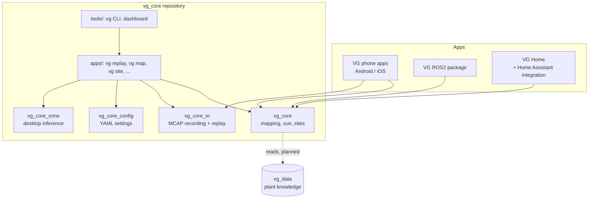
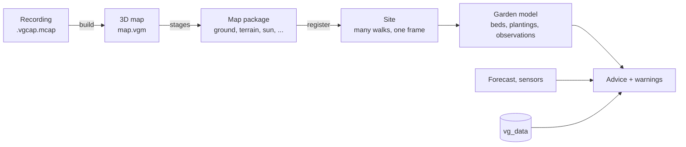

# Architecture

How vg_core fits among the Victory Garden apps, what belongs inside it, and
how data moves from a sensor to advice. For the products themselves see
[vision](vision.md).

## The rule

> **vg_core is computation, data models and file formats. The apps own
> sensors, networking, user interface, scheduling and device control.**

Everything that must behave the same on a phone, a robot and a home server
goes in vg_core. Everything that depends on the platform or talks to the
outside world goes in the app. Some consequences:

| Concern | In vg_core | In the app |
| --- | --- | --- |
| Sensor data | Plain structs in, maps out ([sensor_data.hpp](../include/vg_core/sensor_data.hpp)) | Reading ARCore / ARKit / ROS topics into those structs |
| Recording | The capture format and its writer ([capture-format.md](capture-format.md)) | Deciding when to record, where to store the file |
| Segmentation | Preprocessing, class mapping, labeling depth ([segmentation.hpp](../include/vg_core/segmentation.hpp)) | Running the model (LiteRT, Core ML, ONNX Runtime) behind `InferenceBackend` |
| Weather | Turning a forecast into "bed 3 gets 25 mm, it's a grow bag, it will be waterlogged" | Fetching the forecast from a weather service |
| Warnings | Typed events: `FrostRisk{bed, night, min_temp}` | Showing them: push notification, ROS topic, Home Assistant entity |
| Watering | "Bed 3 needs about 4 L tomorrow" | Opening the valve (VG Home) |
| Units | SI everywhere | Feet, inches, °F for US users, at display time |
| Plant knowledge | Reading the vg_data dataset, reasoning with it | Downloading dataset updates |

Keeping the network out of vg_core means it runs and is tested offline, and
gives the same answer on every host for the same inputs.

## Pieces

What exists today, by CMake target:

| Target | Holds | Depends on |
| --- | --- | --- |
| `vg_core` | Map building, derived maps, sun, sky, registration, sites, segmentation steps | Eigen only |
| `vg_core_io` | Reading and writing recordings (MCAP + protobuf), replaying them into a map package | vg_core, MCAP, zstd, protobuf lite |
| `vg_core_config` | Every pipeline setting, bound to YAML paths and command-line flags | vg_core, vg_core_io, yaml-cpp |
| `vg_core_onnx` | An `InferenceBackend` on ONNX Runtime, for labeling on a PC | vg_core, ONNX Runtime |
| `apps/` | Command-line tools, run as `vg <name>` | All of the above |
| `tools/` | The `vg` Python CLI, heatmaps, the dashboard | Python ≥ 3.10 |

`vg_core` has no dependency beyond Eigen on purpose: it builds for the Android
NDK, iOS, Linux (ROS2) and desktops with no extra work. Heavier libraries
stay in the optional targets.

The [code tour](code-tour.md) goes through each module.

## Data flow

1. **Record.** The phone (or robot) writes a capture session: images, depth,
   poses, IMU, GPS, and optionally semantic labels. Format:
   [capture-format.md](capture-format.md).
2. **Build.** The session is replayed into a 3D voxel map (a TSDF volume),
   placed on the Earth from GPS. See [pipeline/building.md](pipeline/building.md).
3. **Derive.** Stages read the 3D map and write 2D maps: surface, ground,
   terrain, features, canopy, sun hours. Each can be re-run with new settings
   without the recording. See [pipeline/derived-maps.md](pipeline/derived-maps.md)
   and [pipeline/sun-and-sky.md](pipeline/sun-and-sky.md).
4. **Register.** Each walk's package lines up with the walks before it in one
   site frame, so the site keeps the latest view of every spot and the change
   since the last. See [pipeline/sites.md](pipeline/sites.md).
5. **Model the garden** (designed, not built). Beds, plantings and
   observations live in the site frame and are summarized from its maps. See
   [design/garden-model.md](design/garden-model.md).
6. **Advise and warn** (planned). The garden model, plant knowledge from
   vg_data and forecasts or sensor readings from the app produce
   recommendations and events. See [roadmap](roadmap.md).

## Who owns the data

From [decisions](decisions.md#d2-the-phone-app-stands-alone-vg-home-owns-the-data-when-present):

- **No VG Home:** the phone holds the site and the garden model, and does
  everything itself: builds maps, registers walks, gives advice.
- **With VG Home:** VG Home holds the master copy. Phones and robots send it
  recordings (or packages) and garden edits; it registers walks, keeps the
  site, and sends the current maps and garden back. A phone away from home
  keeps working on its copy and sends its edits on return.

The garden model is designed for this from the start (an ordered log of
edits, see [design/garden-model.md](design/garden-model.md#sync)). Map data is
simpler: walks are added, never edited, so the owner just registers whatever
arrives.

## Bindings (planned)

Each app reaches vg_core differently:

| App | Language | How it calls vg_core |
| --- | --- | --- |
| vg_flutter UI (Android, iOS, desktop) | Dart | `dart:ffi` over the C API |
| vg_flutter capture plugins | Kotlin, Swift | JNI / Swift's C interop over the C API |
| ROS2 | C++ | Directly |
| VG Home | Python (to sit beside Home Assistant) | pybind11 module |

Several of these need a **C API** (`vg_core_c`): a small, stable set of
`extern "C"` functions over the C++ classes. One C API serves Swift, Dart and
any other language with a C FFI, so it's worth designing once instead of a
wrapper per platform. Not started; see the [roadmap](roadmap.md).

## Conventions across the code

- **Units:** SI (meters, seconds, radians) in code and files. Degrees appear
  only in settings and output meant for people, and the name says so
  (`max_incidence_deg`).
- **Frames:** right-handed, world z up, camera frames in the OpenCV convention.
  See [capture-format.md](capture-format.md#conventions).
- **Time:** nanoseconds on the session's monotonic clock in sensor data
  (`vg::Timestamp`); UTC seconds since the Unix epoch for sun calculations.
- **Grids:** `HeightMap` cells are row-major, row = y, NaN for no data.
- **Errors:** functions that read files or get bad input throw
  `std::runtime_error` (or `std::invalid_argument`); stages that can't run for
  lack of input return `false` and write nothing.
- **Determinism:** the same inputs and settings give the same bytes (map files
  are written in sorted block order; multithreaded fusion gives the same result
  for any thread count).
