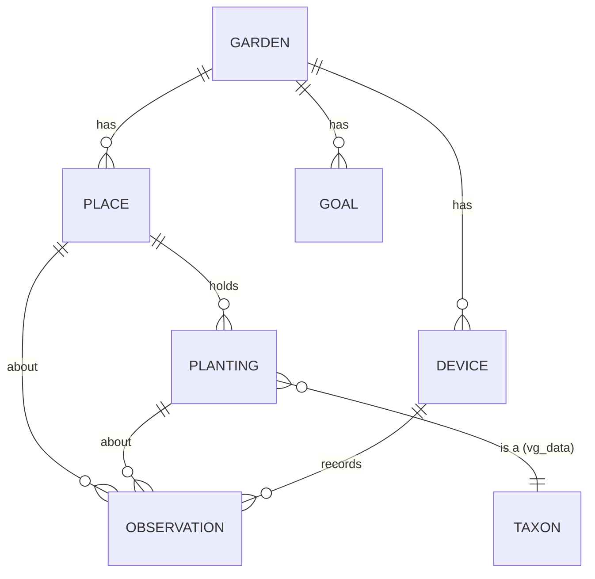

# Garden model

Status: Proposed · Updated: 2026-11-14

## Summary

vg_core knows the yard as grids: surface, ground, terrain, sun hours. A
gardener thinks in beds, containers and plants. The garden model adds those
things (**places**, **plantings** and **observations**) in the site frame,
answers questions about them from the maps ("this bed gets 5.2 h of sun a day
in June, from 90% of its area mapped"), and stores them so the phone and VG
Home can share them. It's the base for priority 2 (planning and tracking) and
everything after it.

## Goals

- Represent the gardener's places, plantings and observations, tied to the
  site's maps by position.
- Summarize any map over a place, with uncertainty and coverage reported, not
  hidden.
- Work fully on the phone, offline. Sync with VG Home, which owns the data
  when present.
- Keep a history: what was planted where in past seasons (crop rotation,
  yields, "what went wrong last year").
- Be the input to recommendations later: suitability, companions, water,
  warnings.

## Non-goals

- **Plant knowledge.** What a tomato needs lives in vg_data
  ([plant-data.md](plant-data.md)); the garden model only refers to it.
- **User interface.** How beds are drawn is the app's concern. The model
  takes polygons.
- **Weather fetching, notifications, device control.** App concerns (see
  [architecture](../architecture.md#the-rule)).
- **Detecting beds automatically.** Drawn by the user first. Proposing them
  from `features.asc` and the ground stage's segments is a later step that
  produces suggestions for the user to accept.

## Background

What this builds on:

- **The site frame** ([pipeline/sites.md](../pipeline/sites.md)): one stable
  frame for all walks, defined by the first. Positions in it stay put as walks
  are added.
- **The site's current maps** (`current/`): each cell from the latest walk
  that saw it, with `visit.asc` saying which. Every value has a date.
- **The geo-reference**: relates the site frame to latitude and longitude, so
  the model can be exported as GeoJSON, and the sun and weather can be placed.

## Design

### Entities



**Garden**: one per site.

| Field | Type | Notes |
| --- | --- | --- |
| id | UUID | |
| name | text | "Back yard" |
| site | path | The site directory it belongs to |
| time_zone | IANA name | "America/Chicago". Planting dates and "tonight" depend on it. |
| region | derived | Hardiness zone, frost dates: looked up in vg_data from the geo-reference, cached here with the dataset version |

**Place**: an area the gardener grows in or cares about.

| Field | Type | Notes |
| --- | --- | --- |
| id | UUID | |
| name | text | "Bed 3", "South fence border" |
| kind | enum | `in_ground_bed`, `raised_bed`, `container`, `grow_bag`, `lawn`, `border`, `tree_area`, `other` |
| outline | polygon | Site frame, meters, counter-clockwise. A container may be a circle (center + radius). |
| height | m, optional | Rim above the terrain for raised beds and containers. Measurable from the maps. |
| volume | L, optional | Containers and grow bags. |
| soil | struct, optional | Texture (sand, loam, clay, potting mix), drainage (`free`, `moderate`, `poor`), organic matter. Unknown is a valid value, not a default. |
| irrigation | struct, optional | `none`, `drip`, `sprinkler`, `hand`; for VG Home, the zone or device that waters it. |
| active | date range | When it existed. A bed removed in 2027 is kept, ended, for history. |

The place kind matters for water: a grow bag drains and dries far faster than
in-ground soil, and a raised bed sits between them. That's why water
estimates belong to places, not cells.

**Planting**: one kind of plant in a place, from plan to removal.

| Field | Type | Notes |
| --- | --- | --- |
| id | UUID | |
| place | Place id | |
| taxon | vg_data id + dataset version | Species or cultivar: `solanum-lycopersicum/cherokee-purple` |
| where | point, line or polygon, optional | Within the place: a single plant, a row, a patch. Defaults to the whole place. |
| count | int, optional | |
| method | enum | `seed`, `transplant`, `perennial`, `volunteer` |
| status | enum | `planned` → `planted` → `growing` → `harvested` / `removed` / `failed` |
| dates | local dates | planned, sown, transplanted, first harvest, ended. Calendar dates in the garden's time zone, not instants. |

`planned` plantings are how planning works: the gardener (and later the
recommender) lays out next season, and suitability is checked before anything
goes in the ground.

**Observation**: something recorded at a time.

| Field | Type | Notes |
| --- | --- | --- |
| id | UUID | |
| subject | Place, Planting, or a point | |
| time | UTC instant | |
| kind | enum | `note`, `photo`, `measurement`, `health`, `harvest`, `pest_sighting`, `care` (watered, fed, pruned) |
| source | struct | `user`, `phone_model`, `sensor`, `robot`; with model or device id and version |
| value | per kind | A measurement has quantity, value, unit, and uncertainty; a health check has a class and confidence; a harvest has mass or count. |
| media | refs, optional | Photos stored beside the garden, by content hash. |

Observations are only ever added (corrections are new observations that
supersede old ones), which keeps history honest and makes sync simple.

**Device**: a sensor or actuator VG Home knows about, with a position in the
site frame and optionally a place. Its readings are observations.

**Goal**: reserved for the recommendation system: what the gardener wants
(a crop, a harvest window, pollinators, low maintenance). Only the
entity is reserved now; its fields come with the recommender's own design.

### Positions

Everything is positioned in the **site frame**, in meters, not in latitude
and longitude:

- The site frame is accurate to centimeters between walks; GPS is off by
  meters. A bed drawn in GPS coordinates would land on the lawn.
- The maps are in the site frame, so summarizing a place over a map needs no
  conversion.
- Latitude and longitude are always available through the geo-reference, for
  GeoJSON export and for the sun and weather.

The first walk defines the site frame and later walks never change it, so
stored positions stay valid. If a site ever has to be re-anchored (a bad
first walk), the re-anchoring transform is applied to every stored position
as one recorded edit.

### Place summaries

The core query: a map, reduced over a place.

```cpp
namespace vg::garden {

struct Summary {
  double mean = NAN, min = NAN, max = NAN;
  double p10 = NAN, p50 = NAN, p90 = NAN;  // Spread across the place.
  double coverage = 0.0;      // Share of the place's area with data, 0..1.
  double area_m2 = 0.0;
  std::string newest_visit;   // When the freshest data in it was recorded.
  std::string oldest_visit;   // ... and the stalest.
};

// Reduces a site grid (sun_hours, features, ...) over a polygon in the same
// frame. Cells count by the share of their area inside the polygon.
Summary summarize(const HeightMap& grid, const Polygon& outline,
                  const HeightMap* visit = nullptr);

}  // namespace vg::garden
```

Rasterizing the outline weights each cell by the share of its area inside,
so small containers (a 30 cm pot covers about four 6-inch cells) aren't
distorted by cells clipped at the edge.

Planning questions become summaries joined with vg_data:

| Question | Maps | Knowledge |
| --- | --- | --- |
| Does this bed get enough sun for tomatoes? | sun hours (per month, see below) | Taxon's light needs |
| Which end of the lawn suits this plant? | sun hours, compared across the place | Taxon's light needs |
| Will this grow bag be waterlogged after Thursday? | rain exposure (planned) + forecast | Place kind, volume, soil |
| Do these two grow well together? | – | Companion relations |
| How much did the beans grow since last week? | `changes.asc` over the planting | – |

### Accuracy

From [decisions.md](../decisions.md#d3-precise-results-simplified-only-for-display):
compute precisely, carry uncertainty, simplify only at display.

Every derived value the garden model returns carries:

- **spread**: the range across the place (p10–p90), not just the mean. A bed
  shaded at one end is two different beds for a tomato.
- **coverage**: how much of the place the maps actually saw. Below a
  threshold the app says "map this bed to get its sun hours" instead of
  showing a number.
- **age**: which walk the data came from. A canopy mapped in March says
  nothing about June leaves.
- **assumptions**: for sun, clear sky and open space beyond the map;
  reported with the value until the model removes them
  ([pipeline/sun-and-sky.md](../pipeline/sun-and-sky.md#assumptions-and-what-they-mean-for-accuracy)).
- **provenance**: the vg_core version, stage settings and vg_data version that
  produced it.

The app decides how much of this to show. vg_core never drops it.

### What this needs from the maps

Two pipeline changes come before useful planning:

1. **Sun by month.** One annual total can't answer "enough sun in June". The
   sun stage should write per-month sun hours (12 bands, or a multi-band
   file) and the gardener's growing season is then a sum. Cost is the same
   ray casting, binned differently.
2. **Sun over the site.** Today sun maps are per walk. Places live in the
   site, so the sun stage needs to run over the site's combined maps and
   canopy, with a site-wide geo-reference from every walk's GPS.

Both are on the [roadmap](../roadmap.md).

### Storage

The garden lives inside its site directory:

```
garden-site/
  site.csv
  current/
  garden/
    garden.sqlite   entities and the edit log
    media/          photos by content hash (sha256.jpg)
```

**SQLite**, because:

- it runs everywhere vg_core does (one C file; the Android NDK and iOS ship
  it), and Python reads it with no dependency, so VG Home and the tools can
  open the same file;
- entities have relations and get queried by place, date and kind;
- writes are atomic, so a phone killed mid-edit doesn't corrupt the garden.

Geometry is stored as text (a list of x, y pairs in meters) to stay readable
and avoid a spatial extension; places number in the dozens, so spatial
indexing isn't needed.

All units are SI. Dates in the garden's time zone are stored as
`YYYY-MM-DD`; instants as UTC.

### Sync

Every change is an **edit** (`add_place`, `move_place_outline`,
`set_planting_status`, `add_observation`, ...) appended to an edit log, and
the entity tables are the result of applying the log in order.

- **Without VG Home** the phone is the only writer; the log is simply its
  history.
- **With VG Home** the home's log is the master. A phone sends its edits;
  VG Home applies them in the order received, assigns each a sequence number,
  and sends back everything the phone hasn't seen. The phone replays its own
  unconfirmed edits on top (as a rebase).
- **Conflicts** are rare in a garden (two people moving the same bed outline
  within minutes) and resolve field by field: the later edit by VG Home's
  order wins, and the overwritten value stays in the log. Observations never
  conflict since they're only added.

This is the "server orders the log" model. It is simpler than CRDTs and fits
"VG Home owns the data when present"
([decisions.md](../decisions.md#d2-the-phone-app-stands-alone-vg-home-owns-the-data-when-present)).
It also gives history and undo for free.

Map data syncs differently: walks are added and never edited, so the owner
registers whatever recordings or packages arrive.

### API sketch

```cpp
namespace vg::garden {

class Garden {
 public:
  // Opens (or creates) site_dir/garden/garden.sqlite.
  static Garden open(const std::filesystem::path& site_dir);

  std::vector<Place> places(const Date& on) const;   // Active on a date.
  std::vector<Planting> plantings(PlaceId) const;
  std::vector<Observation> observations(const Query&) const;

  // Every change is an Edit; apply() validates, logs and applies it.
  EditResult apply(const Edit& edit);

  // Sync.
  std::vector<Edit> edits_since(Sequence) const;
  void merge(const std::vector<Edit>& confirmed);

  // Summaries over the site's current maps.
  Summary summarize(PlaceId, const std::string& map) const;
};

}  // namespace vg::garden
```

It goes in a new `vg_core_garden` target, so the mapping library stays free of
SQLite.

## Alternatives considered

| Option | Why not (for now) |
| --- | --- |
| JSON files per entity | No atomic multi-entity edits; queries by date and kind need loading everything. Fine for export, not as the store. |
| Protobuf (already used for recordings) | Good for messages, not for a queryable store. Useful as the wire format for edits during sync. |
| Positions in WGS84 | GPS error (meters) is larger than a bed. Site frame is cm-accurate; WGS84 is derived. |
| CRDT-based sync | Handles multiple masters, but VG Home is the master by decision. Ordered log is simpler and gives history. |
| Places as raster masks | Exact for any shape, but brittle across cell-size changes and awkward to edit. Polygons rasterize on demand. |

## Rollout

Each phase is useful alone.

1. **Places and summaries.** Polygons in the site frame, `summarize()` over
   the existing maps, coverage reported. Command line: `vg garden place add`,
   `vg garden summary`. Shows the join works with today's maps.
2. **Sun by month, sun over the site.** The pipeline changes above.
3. **Plantings with vg_data.** Taxa from vg_data, `planned` plantings, a light
   suitability check per planting.
4. **Observations and media.** Notes, photos, harvests, care.
5. **Sync with VG Home.**
6. **Goals and recommendations.** Their own design.

## Open questions

1. **Drawing on the phone.** Draw over the site's surface or semantic map in
   2D, or in AR in the yard? Probably both: AR to walk a bed's corners, 2D to
   adjust. App design, but it decides how precise outlines will be.
2. **Bed height from maps.** Measure a raised bed's rim height from
   `features.asc` inside the outline automatically, and show it for the user
   to confirm?
3. **Sub-place layout.** Is a point/line/polygon per planting enough, or do
   square-foot-style grids need their own type?
4. **Where media lives with VG Home.** Photos can be large; does the phone
   keep a copy of all of them, or only recent ones?
5. **Multiple gardens per site.** Front yard and back yard as one site with
   two gardens, or two sites? The current proposal is one garden per site.
