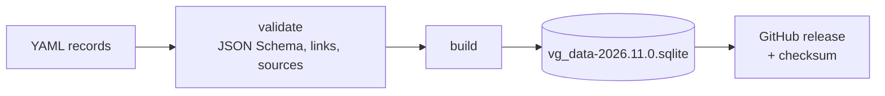

# Plant knowledge data (vg_data)

Status: Proposed · Updated: 2026-11-14

## Summary

A separate repository, **vg_data**, holds what Victory Garden knows about
plants: species and cultivars, what they need, which grow well together,
pests and diseases, and organic remedies. Every claim cites its source and
says how strong the evidence is. It's written as plain text files, checked
automatically, and released as a versioned SQLite file that vg_core and every
app read.

## Why a separate repository

- **Different work, different people.** Adding a cultivar or checking a
  remedy is horticulture, not C++. Reviewers of data don't need to build the
  code, and the reverse.
- **Different pace.** Data improves weekly; vg_core releases slowly. Apps can
  update the dataset without an app update.
- **Different license.** Code is Apache-2.0. Data may need a data license
  (CC BY 4.0, or CC BY-SA if a share-alike source is used), and keeping them
  apart keeps that clean.
- **Every app uses it.** The phone, VG Home and the robot all read the same
  release.

The user doesn't mind if it's public. Making it public invites corrections
from gardeners and extension agents, which helps accuracy.

## Goals

- Facts needed for priorities 2–4: light, water, spacing, timing, frost
  tolerance, companions, pests, diseases, organic remedies.
- **A source for every claim**, and an evidence level, so the app can be
  honest about how sure it is
  ([decisions.md](../decisions.md#d3-precise-results-simplified-only-for-display)).
- Organic only, US first ([decisions.md](../decisions.md#d4-organic-only-remedies-us-first)).
- Numbers in SI with ranges, not single values, wherever the sources
  disagree or plants vary.

## Non-goals

- Being an encyclopedia. Only what VG reasons with.
- Images for training health models. Those datasets are large and licensed
  differently; they get their own home when priority 3 starts.
- Prose care guides. Short structured facts with citations; the app writes
  the sentences.

## What's in it

```
vg_data/
  schema/          JSON Schema for every record type
  taxa/            one YAML file per species, cultivars inside
  relations/       companion and antagonist pairs
  problems/        pests, diseases, disorders
  remedies/        organic treatments, linked to problems
  regions/         US hardiness zones and frost-date sources (how to look up)
  sources/         bibliography: one entry per source, cited by id
  tools/           validate, build, release
  LICENSE, README.md, CONTRIBUTING.md
```

### Taxa

Identified by scientific name, with stable slug ids, and cross-referenced to
USDA PLANTS symbols and GBIF ids so records can be checked against outside
taxonomies.

```yaml
id: solanum-lycopersicum
scientific_name: Solanum lycopersicum
common_names: {en-US: [tomato]}
family: Solanaceae
life_cycle: annual          # as grown in most US gardens
light:
  full_sun_hours: {min: 6, ideal: 8}     # direct sun per day, growing season
  sources: [uconn-ext-tomato, ...]
temperature:
  frost_tolerance: none
  germination_soil_c: {min: 16, ideal: [21, 32]}
  sources: [...]
water:
  need: moderate_to_high
  sensitive_to_waterlogging: true
  sources: [...]
spacing_m: {in_row: [0.45, 0.9], between_rows: [0.9, 1.2]}
days_to_maturity: {from_transplant: [50, 90]}
cultivars:
  - id: solanum-lycopersicum/cherokee-purple
    name: Cherokee Purple
    days_to_maturity: {from_transplant: [75, 85]}
    growth_habit: indeterminate
    sources: [...]
```

Cultivars inherit the species' values and override what differs.

### Relations

```yaml
- a: solanum-lycopersicum
  b: ocimum-basilicum
  effect: beneficial          # beneficial | antagonistic | neutral
  mechanism: pest_deterrence  # pest_deterrence | trap_crop | pollinator | shade | nutrient | allelopathy | ...
  evidence: traditional       # trial | extension | traditional
  notes: Widely recommended; controlled trials show mixed results.
  sources: [...]
```

**Evidence levels** matter here more than anywhere. Much companion-planting
advice is tradition with little testing behind it. Levels:

| Level | Meaning |
| --- | --- |
| `trial` | Supported by peer-reviewed field trials |
| `extension` | Recommended by a university extension service or USDA |
| `traditional` | Common gardening advice without a known study |

The app can then say "traditionally grown together" rather than presenting a
tradition as fact, or filter to `trial` and `extension` only.

### Problems

Pests, diseases and disorders (blossom-end rot isn't a disease):

```yaml
id: early-blight
kind: disease               # pest | disease | disorder
cause: Alternaria solani (and A. linariae)
hosts: [solanum-lycopersicum, solanum-tuberosum]
signs: [concentric-ring leaf spots, lower leaves first, yellowing around lesions]
favored_by:                 # conditions, for forecast-based warnings
  temperature_c: [24, 29]
  leaf_wetness_hours: {min: 6}
seasons_us: [summer]
sources: [...]
```

`favored_by` is what lets vg_core warn from a forecast ("three warm, wet
days: early blight risk for the tomatoes in bed 3").

### Remedies

Organic only. Each remedy is one of:

| Category | Examples |
| --- | --- |
| `cultural` | Crop rotation, spacing for airflow, removing infected leaves, resistant cultivars |
| `mechanical` | Row covers, hand-picking, traps, barriers |
| `biological` | Beneficial insects, *Bacillus thuringiensis* |
| `material` | An input allowed in organic production |

```yaml
id: copper-early-blight
problem: early-blight
category: material
active_ingredient: copper (as copper octanoate, etc.)
organic_status:
  nop: allowed_with_restrictions   # 7 CFR 205.601
  basis: [nop-205-601]
how: Apply preventively when conditions favor disease; follow the product label.
cautions: [Copper builds up in soil; NOP requires minimizing accumulation.]
evidence: extension
sources: [...]
```

**What "organic" means here, precisely:**

- Allowed under the USDA **National Organic Program** (7 CFR Part 205):
  synthetic substances only if on the National List (§205.601 for crops), and
  non-synthetic substances unless prohibited (§205.602).
- Products are referred to by **active ingredient and category**, not brand.
  A specific product being OMRI Listed (or on another organic input list) is
  noted when cited, since formulations vary.
- Any product sold with pest-control claims must be **EPA registered**, or
  exempt as a minimum-risk pesticide (FIFRA 25(b)); states may add their own
  registration. The app always says to follow the product label, which is the
  legal instruction for use.
- Cultural and mechanical remedies come first in every list. They are the
  heart of organic practice, and they carry no product risk.

### Regions

US hardiness zones and frost dates depend on location. vg_data records
**where they come from** (USDA Plant Hardiness Zone Map; NOAA climate normals
for freeze probabilities) and ships a compact lookup table built from them,
so the phone can answer offline from its geo-reference.

### Sources

```yaml
id: uconn-ext-tomato
kind: extension             # trial | extension | government | book | website
title: ...
publisher: University of Connecticut Extension
url: ...
accessed: 2026-11-14
license_note: Facts only; text not copied.
```

## Licensing of sources

Facts aren't copyrightable, but text and compilations can be. Rules for
contributors:

- Write descriptions in our own words; cite, don't copy.
- US federal government works (USDA, NOAA, EPA) are generally public domain.
- University extension publications are usually copyrighted text: use the
  facts, cite the publication.
- Don't import a database wholesale without checking its license. A
  share-alike (CC BY-SA) source makes the combined dataset share-alike; a
  non-commercial source can't be used if VG is ever sold.

## Build and release



- **Validation** in CI: every record matches its schema; every reference (a
  relation's taxa, a remedy's problem, every source id) resolves; every claim
  has at least one source.
- **Build** compiles the YAML into one SQLite file with a `meta` table
  (dataset version, schema version, build date, source count).
- **Versions**: `YEAR.MONTH.PATCH` for the data; a separate integer **schema
  version** that vg_core checks. New data in the same schema is safe to pick
  up automatically; a new schema needs a vg_core that knows it.
- Apps download new releases and keep the last good one. A garden's derived
  values record the dataset version they used.

## In vg_core

A small reader in a `vg_core_knowledge` target (SQLite, like the garden
model's store) gives typed access:

```cpp
namespace vg::knowledge {
class Dataset {
 public:
  static Dataset open(const std::filesystem::path& sqlite);  // Checks schema version.
  std::optional<Taxon> taxon(std::string_view id) const;
  std::vector<Relation> relations(std::string_view taxon_id) const;
  std::vector<Problem> problems_of(std::string_view taxon_id) const;
  std::vector<Remedy> remedies(std::string_view problem_id) const;  // Cultural first.
  std::string version() const;
};
}
```

The garden model and the recommenders use it. Apps never parse the SQLite
themselves, so the schema can change behind the reader.

## Rollout

1. **Repository and schema**, with validation, and about 30 common US garden
   vegetables and herbs with light, temperature, spacing and timing.
2. **Relations** for those, with evidence levels.
3. **Regions**: hardiness zone and frost-date lookup.
4. **Problems** for the same crops: the most common pests and diseases.
5. **Remedies**: cultural and mechanical first, then materials with their
   NOP status.

Steps 1 and 3 are what priority 2 needs; steps 4 and 5 serve priorities 3
and 4.

## Open questions

1. **Name.** `vg_data`, or something more specific (`vg_plants`,
   `vg_knowledge`)?
2. **Review.** Who checks remedy entries? An extension Master Gardener
   reviewing changes to `remedies/` would add a lot of trust.
3. **Flowers and fruit trees.** Start with vegetables and herbs, or include
   common flowers and fruit from the start?
4. **Ornamental vs. edible safety.** A remedy safe on roses may not be
   allowed on food crops close to harvest (pre-harvest intervals). Record the
   interval per remedy from the start?
