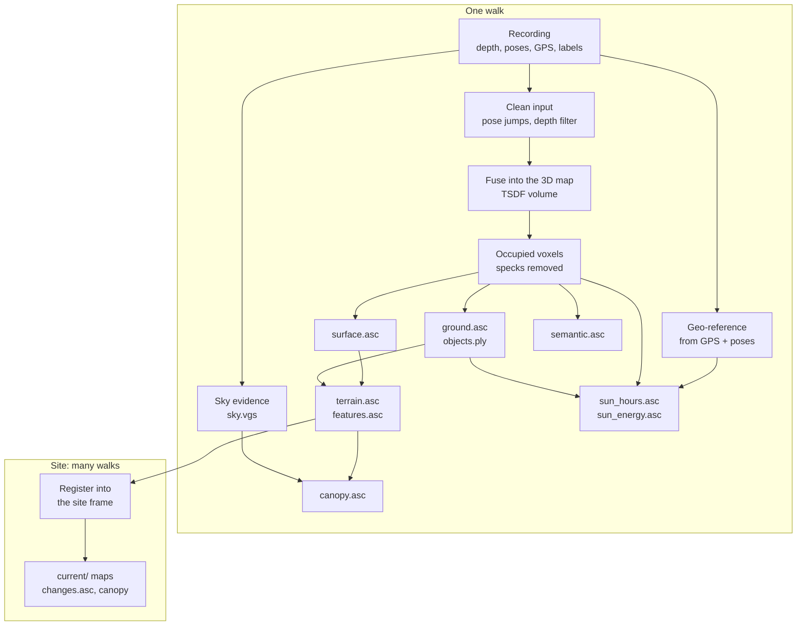

# The mapping pipeline

How a walk around the yard becomes maps of the garden. This page is the
overview; each stage has its own page.

## Stages

| # | Stage | Reads | Writes | Page |
| --- | --- | --- | --- | --- |
| 0 | Record | sensors | `.vgcap.mcap` | [capture-format.md](../capture-format.md) |
| 1 | Build | recording | `map.vgm`, `trajectory.csv`, `sky.vgs` | [building.md](building.md) |
| 2 | voxels | `map.vgm` | `voxels.ply`, `labels.ply` | [derived-maps.md](derived-maps.md#voxels) |
| 3 | surface | `map.vgm` | `surface.asc` | [derived-maps.md](derived-maps.md#surface) |
| 4 | ground | `map.vgm` | `ground.asc`, `ground_patched.asc`, `objects.ply` | [derived-maps.md](derived-maps.md#ground) |
| 5 | terrain | `ground.asc`, `surface.asc`, `trajectory.csv` | `terrain.asc`, `features.asc` | [derived-maps.md](derived-maps.md#terrain) |
| 6 | sky | `sky.vgs`, `terrain.asc` | `canopy.asc`, `canopy_top.asc`, `canopy.ply` | [sun-and-sky.md](sun-and-sky.md#sky-and-canopy) |
| 7 | sun | `map.vgm`, `ground.asc` | `sun_hours.asc`, `sun_energy.asc` | [sun-and-sky.md](sun-and-sky.md#sun-map) |
| 8 | semantic | `map.vgm` | `semantic.asc` | [semantics.md](semantics.md) |
| – | layers | `map.vgm` | `layers.asc` (diagnostic) | [derived-maps.md](derived-maps.md#layers-diagnostic) |
| 9 | Site | packages | `site.csv`, `current/` | [sites.md](sites.md) |

Stage 1 needs the recording; every later stage reads only the package's own
files. That split is the most important design choice in the pipeline: the
recording is large (about 1.5 GB for a five-minute walk) and slow to replay,
while re-running a stage takes seconds. So a derived map can be re-tuned, or
improved by new code, without walking the yard again.

## Where it runs

- **On the phone, live.** `MapBuilder` builds the 3D map and a height map as
  the user walks, for the on-screen preview. See
  [building.md](building.md#live-on-the-phone).
- **From a recording.** `vg replay` (in code, `vg::io::build_map_package`)
  replays a recording into a package, then runs the stages listed in the
  `pipeline` setting. This is how development works today. The phone will run
  the same code after a walk.
- **Re-running stages.** `vg map <package> <stage>...` (in code, `MapPackage`).

## Settings

Every number the pipeline uses is a setting, listed with its default and an
explanation in [config/mapping.yaml](../../config/mapping.yaml). A package
stores the settings it was made with (`config.yaml`), and its `manifest.json`
records what each stage last ran with, so any map can be traced back to how
it was made. See the README's [Settings](../../README.md#settings).

## Accuracy, in numbers

Known limits, measured on real walks. Each is explained on its stage's page.

| What | How good | Why |
| --- | --- | --- |
| Depth range used | 3.5 m | Phone depth error grows with the square of range |
| Phone height over ground (for terrain) | ±18 cm per point | People don't hold the phone perfectly steady |
| Map heading from GPS | Tens of degrees on a short walk; reported as `heading_sigma` | Phone GPS error is meters |
| Walk-to-walk alignment | About 0.5 m and 2° | Each walk's own drift, which one rigid transform can't remove |
| Sun position | About 0.01° | NOAA algorithm |
| Sun hours | Clear sky only; open space beyond the map assumed | No weather yet; unmapped trees don't shade |
